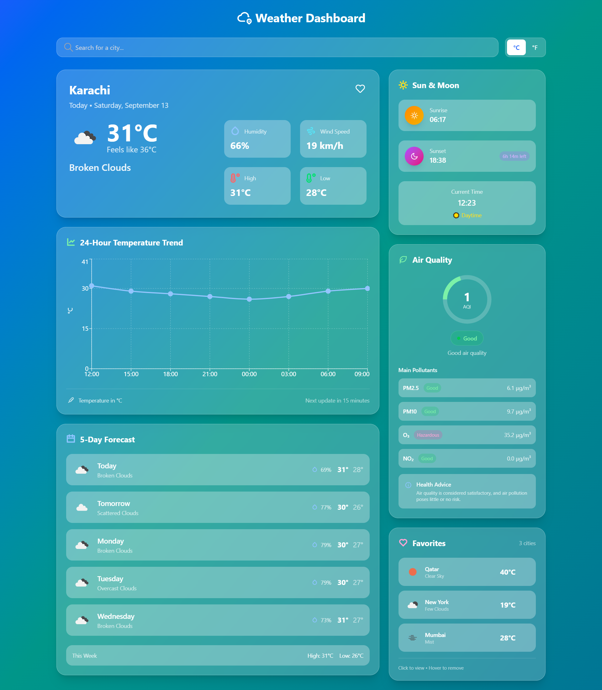
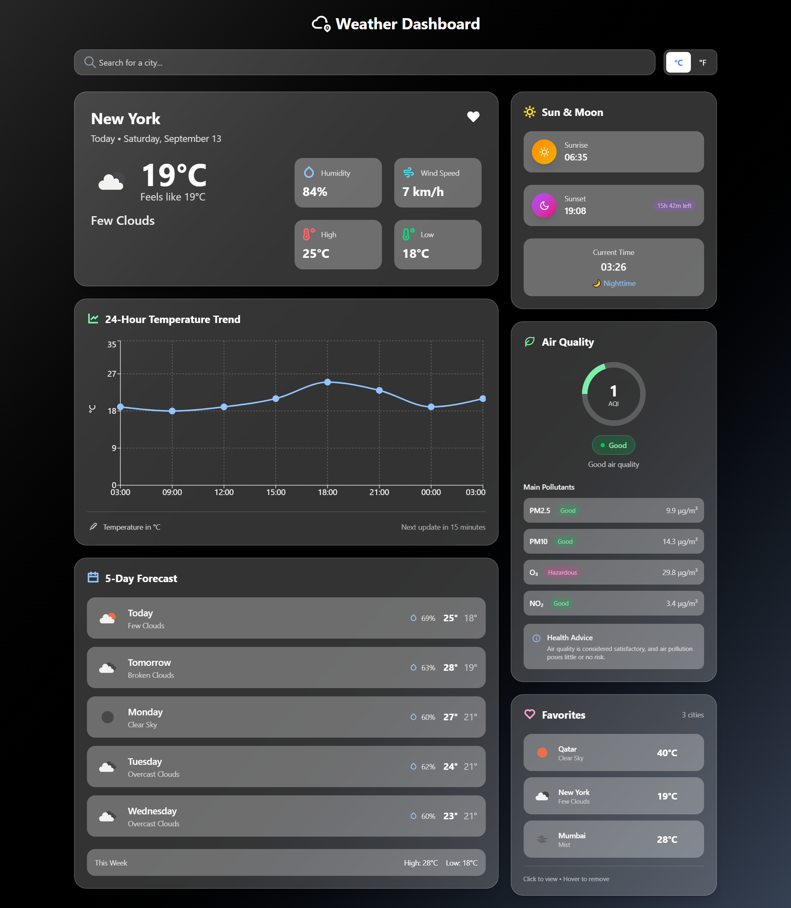

# 🌦️ Weather Dashboard

A modern, responsive **Weather Dashboard** built with **React + Vite** that displays current weather, forecasts, air quality, sunrise/sunset timings, and favorite cities.  
The app uses the [OpenWeather API](https://openweathermap.org/) to fetch real-time data and provides an intuitive UI with smooth gradients for day/night themes.

---

## ✨ Features

- 🔍 **Search any city** to view its current weather conditions
- 🌡️ **Current weather** with temperature, condition, and description
- 📈 **Hourly forecast chart** for upcoming weather trends
- 📅 **5-day forecast** with temperature and condition summaries
- ☀️🌙 **Sunrise & sunset timings** with day/night detection
- 🍃 **Air quality index (AQI)** integration
- ⭐ **Favorites system** — add/remove cities with one click (stored in `localStorage`)
- 🎨 **Dynamic background** that changes based on time (day/night gradient)
- 📱 **Responsive design** that works on desktop & mobile

---

## 🖼️ Screenshots





---

## 🛠️ Tech Stack

- **Frontend:** React (Vite), Tailwind CSS
- **Icons:** React Icons
- **Charts:** Recharts
- **Data Source:** [OpenWeather API](https://openweathermap.org/)
- **State Management:** React Hooks (`useState`, `useEffect`)
- **Storage:** `localStorage` for favorites

---

## 📦 Installation

1. Clone the repo:
   ```bash
   git clone https://github.com/bismah-nasir/weather_dashboard.git
   cd weather_dashboard
   ```

2. Install dependencies:
    ```bash
    npm install
    ```

3. Create a .env file in the root and add your OpenWeather API key:
    ```bash
    VITE_APP_ID=your_openweather_api_key_here
    ```

4. Run the development server:
    ```bash
    npm run dev
    ```

5. Open ```http://localhost:5173``` in your browser.

---

## ⚙️ Project Structure

 ```
 weather-dashboard/
 │── public/                # Static assets
 │── src/
 │   ├── api/               # API calls (weather, forecast, air quality)
 │   │   └── weather.js
 │   ├── components/        # UI Components
 │   │   ├── AirQuality.jsx
 │   │   ├── CurrentWeather.jsx
 │   │   ├── Favorites.jsx
 │   │   ├── Forecast.jsx
 │   │   ├── HourlyChart.jsx
 │   │   ├── NavBar.jsx
 │   │   ├── SearchBar.jsx
 │   │   └── SunMoonTimings.jsx
 │   ├── utils/             # Helper functions
 │   ├── App.jsx            # Main entry
 ├── ├── index.css
 │   └── main.jsx           # React root
 │── .env                   # API key (not committed)
 │── README.md
 │── eslint.config.js
 │── index.html
 │── package-lock.json
 │── package.json
 └── vite.config.js
```

---

## 🌍 Environment Variables

The project requires the following environment variable:

```VITE_APP_ID```	OpenWeather API key (required)

---

## 🌐 Live Demo

You can view the live version of the Weather Dashboard deployed on Vercel here: https://weatherly-dashboard.vercel.app/

---

## 🙌 Acknowledgements

- [OpenWeather API](https://openweathermap.org/)
 for weather data

- [Tailwind CSS](https://tailwindcss.com/)
 for styling

- [React Icons](https://react-icons.github.io/react-icons/)
 for icons

- [Recharts](https://recharts.org/)
 for charts

---

## 👨‍💻 Author
Bismah Nasir

[GitHub](https://github.com/bismah-nasir) | [LinkedIn](https://www.linkedin.com/in/bismah-nasir/)

---
